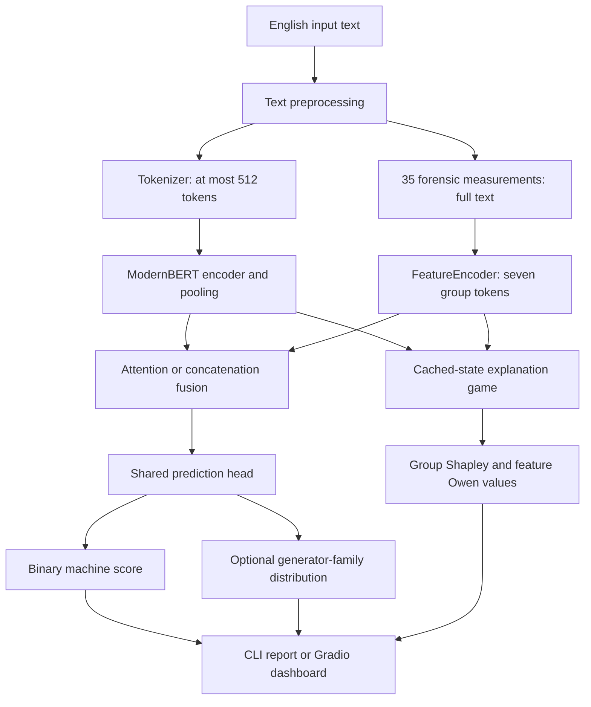

# FLAIRD: system and model architecture

## 1. Scope and evidence

FLAIRD combines a pretrained English text encoder with explicit stylistic measurements to estimate whether a document is machine generated. Its auxiliary head predicts a generator **family**, including a human class. It does not verify factual claims, infer deceptive intent, identify coordinated accounts, or detect a disinformation campaign as a network phenomenon. The thesis title describes the application motivation; the implemented unit of analysis is one text.

This account follows [modeling_flaird.py](../src/flaird/modeling/modeling_flaird.py), [modeling_fusion.py](../src/flaird/modeling/modeling_fusion.py), and [configuration_flaird.py](../src/flaird/modeling/configuration_flaird.py). The eight completed experiments vary fusion, encoder freezing, and auxiliary supervision. They share the same feature extraction and prediction head design. See [results](EVALUATION_RESULTS.md) for evidence rather than assuming that additional architectural complexity guarantees higher accuracy.

## 2. End-to-end system

The diagram describes the training-aligned explanation path. TIRA's on-demand feature extraction uses raw text while tokenization uses preprocessing; this historical difference is preserved and documented in [data](DATASET_PREPARATION.md). It matters when comparing deployed explanations with benchmark scores.

| Layer | Implementation | Responsibility |
|---|---|---|
| Dataset construction | `notebooks/flaird_dataset_preparation.ipynb` | Blend PAN26 and RAID, assign labels, preprocess and materialize features |
| Dataset loading | `src/flaird/data/dataset.py` | Select prepared text, binary label, family label, feature vector |
| Batch collation | `src/flaird/data/data_collator.py` | Dynamic padding, truncation, feature reuse/extraction, tensors |
| Model configuration | `src/flaird/modeling/configuration_flaird.py` | Serializable architecture, label maps, loss weights |
| Linguistic extraction | `src/flaird/modeling/features.py` | Fixed ordered vector of 35 values |
| Learned modeling | `src/flaird/modeling/modeling_flaird.py` | FeatureEncoder, encoder, shared head and task losses |
| Fusion | `src/flaird/modeling/modeling_fusion.py` | Evidence integration and optional attention/gate diagnostics |
| Training | `src/flaird/scripts/train.py`, `src/flaird/trainer.py` | Configuration parsing, pretrained weight loading, Trainer evaluation |
| Inference/evaluation | `predict.py`, `tira_test.py`, `raid_test.py`, `evaluator.py` | Explanations, benchmark submission and metrics |
| Demonstration | `demo/app.py`, `demo/ui/` | Layout, cached model loading, plots and human-readable evidence |
| Publication | `.github/workflows/` | Manually dispatched Space synchronization and TIRA submission |

## 3. Representations and dimensions

Let batch size be $B$, token length $L\leq512$, encoder width $H$, feature-token width $D=128$, and number of feature groups $G=7$. ModernBERT-large uses $H=1024$; the code obtains this from `encoder_config.hidden_size`, rather than hardcoding it.

| Quantity | Tensor shape | Meaning |
|---|---|---|
| `input_ids`, `attention_mask` | $B\times L$ | Token identifiers and padding validity |
| `forensic_features` | $B\times35$ | Raw scalar measurements |
| `semantic_states` | $B\times L\times H$ | Contextual token representations |
| Pooled semantic vector | $B\times H$ | Masked mean by default, or first-token pooling |
| `feature_states` | $B\times7\times128$ | Learned linguistic group representations |
| Query passed to fusion attention | $B\times1\times H$ | One document-level query |
| Fused representation / shared head | $B\times H$ | Input to both task heads |
| Binary logits | $B\times1$ | One machine-positive logit |
| Generator logits, when enabled | $B\times11$ | Ten model families plus human |
| Returned attention / mean gate | $B\times7$, $B$ | Group weights / scalar gate diagnostic |

### 3.1 Semantic encoder and pooling

`from_pretrained_encoder` constructs FLAIRD and copies the pretrained encoder's state dictionary. New feature, fusion and classification layers are initialized separately. This distinction is central to the training-budget discussion.

Masked mean pooling is

$$
h_b=\frac{\sum_{t=1}^{L}a_{bt}S_{bt}}{\max(1,\sum_{t=1}^{L}a_{bt})}.
$$

Here $S$ is the encoder output and $a$ the attention mask. Padding does not dilute the mean. `cls` pooling instead selects `states[:, 0]`. Only the pooled document state enters either fusion implementation. FLAIRD's fusion therefore does **not** perform cross-attention between every word and every feature group. The eight JSON experiments inherit mean pooling from `FlairdConfig`.

ModernBERT supplies pretrained contextual representations, while the forensic stream supplies explicit measurements that may remain informative when a surface pattern is weakly represented in a pooled neural state. Neither stream establishes truthfulness. Removing the encoder would create a stylometric-only detector, which is not one of the completed experiments and would require a separate model path and retraining.

### 3.2 Why FeatureEncoder exists

The raw vector mixes scales and meanings: TTR is fractional, average sentence length may be tens of characters, and Honoré's R can be very large. Directly presenting these scalars as an attention sequence would make units, group identity, and representational capacity difficult to control. `FeatureEncoder` provides three functions:

1. Compress magnitudes with a sign-preserving logarithm.
2. Learn interactions among related features inside each linguistic group.
3. Represent each group in a common 128-dimensional space suitable for attention keys and values.

For raw feature $x_i$ and group index set $I_k$:

$$
\widetilde{x}_i=\operatorname{sign}(x_i)\log(1+|x_i|),
\qquad
f_k=\operatorname{Dropout}\!\left(\operatorname{LN}\!\left(\operatorname{GELU}(W_k\widetilde{x}_{I_k}+b_k)\right)\right).
$$

The group projections have input widths 10, 7, 5, 4, 5, 2 and 2, respectively. The output stack is seven tokens of width 128. There are no corpus mean/variance files, PCA components, or embedding lookups for feature values. Feature dropout is 0.1. In this class `LayerNorm` uses PyTorch's default epsilon; other fusion/head norms explicitly use `config.layer_norm_eps` (default $10^{-5}$).

**Example.** Lexical diversity includes `ttr`, `mtld`, and eight related indicators. Its projection can learn a joint representation of rich vocabulary and repeated tokens. The two entropy indicators pass through a different projection so their numerical patterns are not conflated with lexical diversity before fusion.

**If omitted.** `MultiheadAttention` expects dense, dimensionally compatible keys/values. Feeding one 35-dimensional vector as one token would remove the seven-group attention structure; treating 35 scalars as independent tokens would define a different architecture and explanation hierarchy. A new projection strategy and retraining would be necessary. Removing FeatureEncoder is not equivalent to turning off an optional preprocessing step. Even the concatenation baseline uses the same FeatureEncoder.

**Baseline subtlety.** Zero raw features become zero after the logarithm, but learned linear biases and LayerNorm parameters can yield **nonzero group tokens**. An all-zero feature vector is a reference input, not a guarantee of a silent forensic branch.

### 3.3 Gated multihead cross-attention

The proposed fusion first normalizes the pooled semantic vector and feature tokens. The semantic vector supplies the query; seven feature tokens supply keys and values. PyTorch's attention module accepts `embed_dim=H`, `kdim=D`, `vdim=D` and eight heads, projecting these dimensions internally.

For head $r$, using projected query/key/value matrices:

$$
A_r=\operatorname{softmax}\left(\frac{Q_rK_r^\top}{\sqrt{H/8}}\right),
\qquad C_r=A_rV_r.
$$

The heads are concatenated and output-projected by `MultiheadAttention`. The resulting context is normalized. Each head can learn a distinct matching between document context and linguistic groups; these are learned subspaces, not predefined roles such as “grammar head” or “entropy head.” Returned group attention averages across heads, so it does not preserve all head-specific behavior.

Let $s$ be the normalized semantic vector and $c$ the normalized attention context. Fusion is

$$
g=\sigma(W_g[s;c]+b_g),\qquad
m=c+g\odot(s-c),
$$

$$
u=\operatorname{Dropout}\left(\operatorname{GELU}\left(\operatorname{LN}(W_o[m;s\odot c]+b_o)\right)\right).
$$

The vector gate has $H$ dimensions, allowing dimension-specific mixing. The product $s\odot c$ introduces an explicit multiplicative interaction before the final projection. The returned gate is only its dimension-wise mean. A mean near one favors semantics **inside the gated mixture**; it does not mean that “90% of the prediction came from semantics,” since the product path and nonlinear output remain active.

Without the gate, a fixed mixture would lose input-adaptive coordinate weighting. Without the product, one explicit interaction channel would disappear. These are design rationales, not measured ablation conclusions: the repository does not contain isolated gate/product removal experiments. Attention weights indicate information routing; signed contributions are obtained separately by the explanation game.

### 3.4 Concatenation comparator

The comparator averages the same seven feature tokens, pools semantic states, concatenates both, and projects back to $H$:

$$
\overline f=\frac{1}{7}\sum_{k=1}^{7}f_k,\qquad
u=\operatorname{Dropout}\left(\operatorname{GELU}\left(\operatorname{LN}(W_c[h;\overline f]+b_c)\right)\right).
$$

This branch has no attention or gate. It preserves a learned nonlinear fusion, rather than being a parameter-free baseline. Averaging gives each **group token** equal pre-projection weight, not each raw feature equal weight. It discards direct group-level routing while retaining interactions encoded inside the feature tokens and projection. It has a simpler optimization path and fewer newly initialized parameters than attention fusion.

### 3.5 Shared head and task heads

The common head applies `Linear(H,H)` → GELU → LayerNorm. A dropout (0.1) and linear projection then produce one binary logit. The optional generator head applies its own dropout and `Linear(H,11)` to the same shared representation. Binary scores use sigmoid; generator distributions use softmax.

The generator labels are GPT, Meta-LLaMA, MPT, Cohere, Mistral, Gemini, DeepSeek, Falcon, Bison, Qwen and human (IDs 0–10). They represent dataset-defined families. In particular the mapping of a distilled model to DeepSeek follows corpus labeling, not a verified causal determination of the original generator.

The weighted objective is detailed in [training](TRAINING_CONFIGURATION.md). Auxiliary supervision may make the shared representation sensitive to family-specific patterns, but can also introduce competing gradients and dependence on unbalanced labels. No metric in the archived TIRA tables measures generator identification accuracy directly.

## 4. Experimental variants and boundaries

| Factor | Levels | What it isolates |
|---|---|---|
| Fusion | attention / concatenation | Input-adaptive group retrieval versus averaged feature fusion |
| Encoder | fine-tuned / frozen | Full adaptation versus fixed pretrained semantic weights |
| Supervision | binary only / multitask | Effect of generator-family supervision |

The $2\times2\times2$ design yields eight completed configurations. `flaird-dev-multitask.json` is a small development configuration, not a ninth benchmark experiment. Frozen encoders have `requires_grad_(False)`; ordinary training mode may still activate encoder dropout. Freezing gradients is not identical to permanently putting the encoder into evaluation mode.

No completed configuration removes forensic features or semantics entirely. Consequently the current results do not isolate the absolute benefit of forensic extraction over a matched ModernBERT-only baseline. Architecture claims must respect this boundary.

### 4.1 Parameter burden of the fusion alternatives

Counting parameters directly from the implemented modules at $H=1024$, $D=128$ and the default seven groups gives:

| Newly initialized module | Parameters |
|---|---:|
| FeatureEncoder (shared design) | 7,168 |
| AttentionFusion | 6,566,144 |
| ConcatenationFusion | 1,182,720 |
| Attention-minus-concatenation fusion difference | 5,383,424 |

These counts cover the named modules only, excluding the pretrained encoder and shared/task heads. They quantify the extra optimization burden of attention fusion; parameter count alone does not establish slower convergence or a need for more epochs. The computation instantiates the module definitions and sums parameter tensor sizes, without loading trained weights.

## 5. Explainability and deployment

The explainer runs the encoder once, caches the pooled state, and evaluates masked feature vectors through FeatureEncoder, fusion and task heads. This is valid for both pooling types because the fusion consumes only a pooled semantic state. See [the explanation specification](EXPLAINABILITY_MODULE.md) for mathematical definitions and computational cost.

The demo separates pure HTML/table functions (`components.py`), pure Plotly builders (`plots.py`), orchestration (`controller.py`), tokens/styles (`theme.py`, `style.css`), and layout/events (`app.py`). A registry loads models lazily and retains at most one checkpoint by default. The 30,000-character cap precedes feature extraction; encoder truncation is a second, token-level limit.

Space publication is manual through the sync workflow. It copies `demo/`; `demo/requirements.txt` installs the package from GitHub `develop`. Merging a PR does not automatically synchronize the Space. Publication instructions and dependency provenance are in [the demo guide](DEMO.md).

## 6. Primary references

- Warner et al. *Smarter, Better, Faster, Longer: A Modern Bidirectional Encoder for Fast, Memory Efficient, and Long Context Finetuning and Inference*. [Paper](https://arxiv.org/abs/2412.13663).
- Vaswani et al. (2017). *Attention Is All You Need*. [Paper](https://arxiv.org/abs/1706.03762).
- Jain and Wallace (2019). *Attention is not Explanation*. [ACL Anthology](https://aclanthology.org/N19-1357/).
