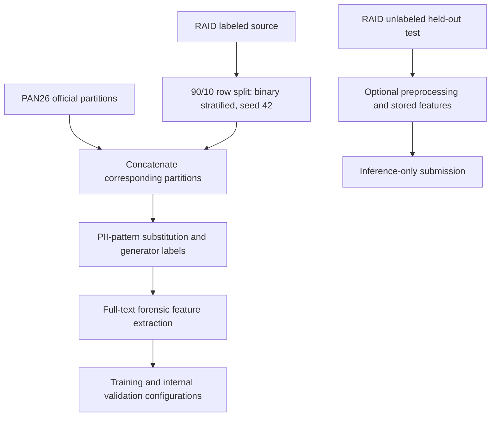
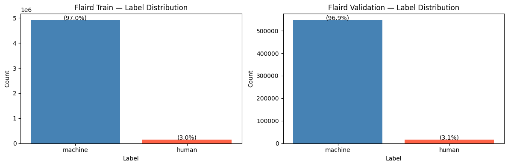
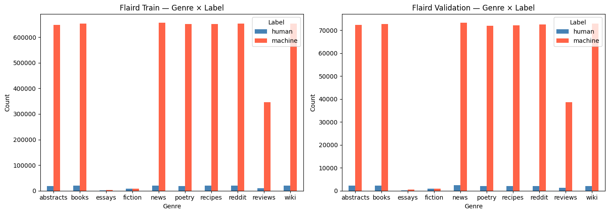
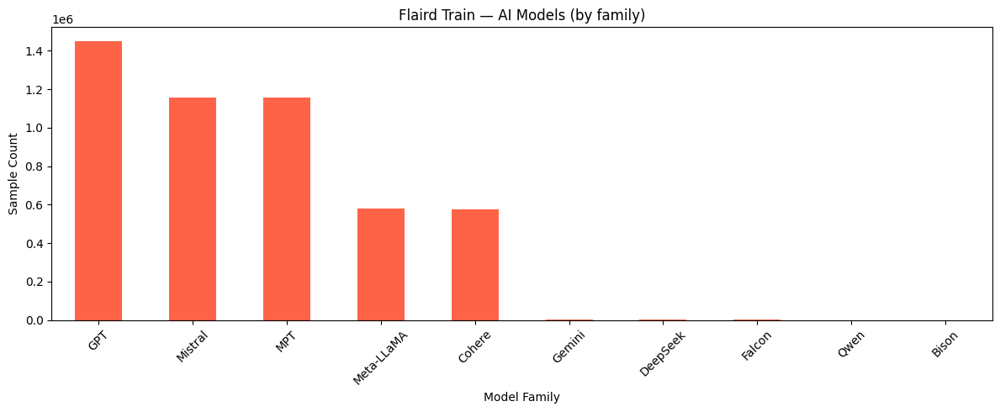
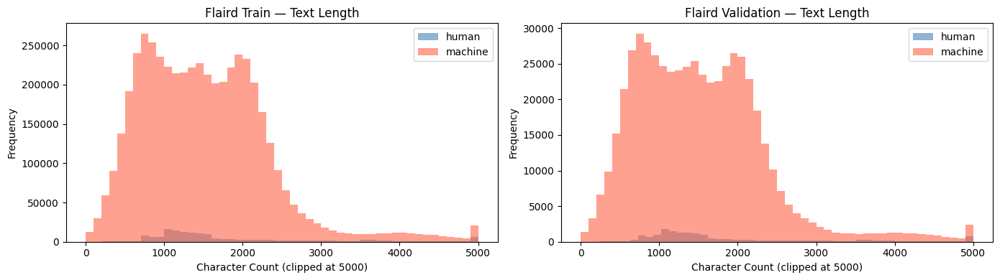

# Dataset preparation and provenance

## 1. Sources and evidential status

This document reconstructs the committed [preparation notebook](../notebooks/flaird_dataset_preparation.ipynb), including textual outputs and its four embedded EDA figures. Cell references below use **zero-based JSON cell indices**, not execution numbers: all code cells have `execution_count: null`, even when outputs are retained. Outputs are historical observations, not evidence that the current file was freshly executed from top to bottom.

The notebook introduction calls the process “leakage-safe cleaning, blending, balancing.” The actual code blends and preprocesses data and later training uses loss weights. It does not implement deduplication, source-group isolation, resampling, or a leakage audit. Those stronger descriptions must not be used for the completed experiment.

| Source / stage | Rows | Notebook evidence |
|---|---:|---|
| PAN26 training | 23,707 | Cell 10 |
| PAN26 validation | 3,589 | Cell 13 |
| RAID labeled source, `liamdugan/raid`, config `raid`, split `train` | 5,615,820 | Cell 24 |
| RAID held-out, config `raid_test`, split `test` | 672,000 | Cell 24; only `id`, `generation` |
| RAID-derived training partition | 5,054,238 | Cell 33 |
| RAID-derived validation partition | 561,582 | Cell 33 |
| Combined FLAIRD training | 5,077,945 | Cells 39, 43, 63 |
| Combined FLAIRD validation | 565,171 | Cells 39, 42, 64 |

The notebook loads PAN from `${HF_USERNAME}/pan26`; the canonical original file revisions and hashes are not recorded. Training configurations consume `MahmoodAnaam/flaird-raid-pan26`. Dataset access and upstream redistribution conditions are separate from the repository's Apache-2.0 software license.

The RAID paper describes eight domains and eleven adversarial attacks, plus the unmodified condition. The notebook's introductory statement about eleven domains and twelve attacks is not used as a verified benchmark description. The combined EDA contains ten genre names, including PAN-specific essays and fiction. See the [RAID paper](https://aclanthology.org/2024.acl-long.674/).

## 2. Preparation procedure

1. Load the PAN training and validation splits and cast binary labels to `ClassLabel([human, machine])`.
2. Load RAID's labeled source and unlabeled benchmark test. Retain `id`, `generation`, `model`, `domain`, `attack`; rename generation to text and domain to genre.
3. Assign human label 0 when `model.lower() == "human"`; assign machine label 1 otherwise.
4. Split labeled RAID rows with `test_size=0.10`, binary stratification and seed 42. The returned `test` partition is used as internal validation, **not** the official RAID held-out test.
5. Attach provenance tags (`pan26-train`, `pan26-validation`, `raid-train`, `raid-validation`) and concatenate corresponding partitions.
6. Substitute email, user-mention and phone-like patterns; map model names to family labels with batched maps of 2,000 rows and four processes.
7. Materialize 35 forensic values for every combined text with the same batch/process settings.
8. Prepare an optional preprocessed/feature-augmented held-out RAID test for inference. Publication calls specify separate Hub configurations.

There is no visible train/test contamination through using held-out RAID labels: they are absent from the loaded test schema. However, source-level overlap **inside the row-split training/validation source** is not ruled out. RAID attack variants can be related to the same source. `source_id` and `adv_source_id` are dropped before the split, preventing a source-isolation check from the retained schema alone.

## 3. Preprocessing and schema

Email-like strings become `[EMAIL]`, mentions become `[USER]`, and phone-like patterns become ` [PHONE]`, followed by trimming. This reduces direct identity strings and some formatting variation; it is not comprehensive PII anonymization. The phone regex is broad and can also replace ordinary long numeric strings. Whitespace, punctuation, Unicode substitutions and letter case otherwise remain available to extraction, subject to library chunk behavior.

| Column | Meaning / use |
|---|---|
| `id` | Original row identifier; retained for traceability |
| `dataset` | Source partition tag |
| `text` | Preprocessed English text |
| `genre` | Source domain/genre |
| `attack` | RAID attack condition; PAN rows have missing values |
| `model` | Dataset generator/model designation |
| `model_family` | Family grouping used for analysis |
| `label` | 0 human, 1 machine |
| `generator_label` | Integer family label, including human |
| `forensic_features` | Ordered list of 35 raw values |

Training's loader selects only text, label, generator label and stored features. It reads the first split exposed by each requested dataset configuration; the documented configurations are intended to expose the corresponding single split. The notebook's pandas output also contains `text_len` before the visible cell that creates it, indicating retained execution state or out-of-order execution. This auxiliary column is not part of the saved feature dataset schema shown in cells 63–64.

## 4. Generator families and class imbalance

The family names are a training label taxonomy. They do not identify exact model versions at inference. The following training counts are retained in cell 59; human count is **derived** by subtracting their sum from the recorded total.

| ID | Family | Training rows |
|---:|---|---:|
| 0 | GPT | 1,450,356 |
| 1 | Meta-LLaMA | 579,466 |
| 2 | MPT | 1,155,473 |
| 3 | Cohere | 577,318 |
| 4 | Mistral | 1,156,816 |
| 5 | Gemini | 2,692 |
| 6 | DeepSeek | 901 |
| 7 | Falcon | 879 |
| 8 | Bison | 265 |
| 9 | Qwen | 271 |
| 10 | human | 153,508 (derived) |
| — | Total machine | 4,924,437 (sum) |
| — | Total | 5,077,945 |

Machine prevalence is approximately 96.98%; human prevalence approximately 3.02%. `153508 / 4924437 = 0.0311727005543984`, matching the binary positive weight in the experiment JSON files. The notebook contains no visible code that derives the auxiliary class weights; the stored values, rather than an inferred inverse-frequency formula, are documented in [training](TRAINING_CONFIGURATION.md). The smallest families have only hundreds of rows, limiting claims about family generalization.

Mapping details include `gpt2`, `gpt3`, `chatgpt`, GPT-4 variants and o3-mini → GPT; LLaMA variants → Meta-LLaMA; Mistral/Mixtral/Ministral → Mistral; `deepseek-r1-distill-qwen-32b` → DeepSeek. See cell 41 for the full mapping. `generator_label_for_model` expects a known non-null designation and raises for unknown values; it does not define an unknown family.

## 5. Preserved EDA figures

These figures are extracted directly from the committed notebook, without regenerating the data or adjusting their measurements.

The recorded chart rounds machine prevalence to 97.0% in training and 96.9% in validation. It supports the use of imbalance-aware training; it does not establish a calibrated operational prior.

The genre bars show substantial differences in support. Machine rows dominate, while essays and fiction have much smaller visible support than the RAID-derived domains. Precise per-genre counts are not retained as a numeric table, so this document does not invent them from pixel heights.

GPT, Mistral and MPT dominate machine examples. Minority-family attribution or classification should therefore be assessed with per-class metrics; overall binary performance does not establish uniform family performance.

Histograms use characters and clip values at 5,000 **for plotting only**. The plot does not impose a 5,000-character training limit. Much of the distribution lies roughly between 500 and 2,000 characters, with a long tail. No exact median or quantiles are recoverable from the saved textual outputs. The encoder's 512-token limit is a different unit and can truncate documents even when a full-text feature vector is available.

## 6. Published configurations and execution evidence

| Hub configuration requested by notebook | Split | Contents | Saved success output? |
|---|---|---|---|
| `flaird_train` | train | Combined prepared rows | No |
| `flaird_validation` | validation | Combined prepared rows | No |
| `raid_test` | test | Original unlabeled held-out rows | No |
| `flaird_train_features` | train | Combined rows plus 35 features | No |
| `flaird_validation_features` | validation | Combined rows plus 35 features | No |
| `raid_test_features` | test | Preprocessed held-out rows plus features | No |

The user reports that all training/evaluation experiments are complete. This is accepted as project status. The committed notebook itself provides sizes and EDA outputs, but no saved confirmations for Hub pushes, and no saved output for the held-out feature preparation cell. The two statements are compatible: absence of notebook output is not evidence that work was not performed.

See [NOTEBOOK_EXECUTION_AUDIT.md](NOTEBOOK_EXECUTION_AUDIT.md) for the cell-by-cell record.

## 7. Training/inference alignment and limitations

Training uses already preprocessed text and stored features with collator preprocessing disabled. The explainer preprocesses text then extracts features from that preprocessed text. TIRA uses the default collator, which preprocesses tokenization input but extracts features from the **raw original** when no stored feature column is supplied. RAID can reuse prepared test features, or extract from supplied text depending on CLI options. These routes can differ for emails, mentions, numbers and whitespace; archived scores should retain their historical input path.

This documentation/UI release does not rebuild the dataset or modify the split, features, checkpoints or training settings. Rebuilding them would change the experimental object. A stronger future protocol would group all variants of a source before splitting, audit cross-corpus near duplicates, record revisions and exact dependencies, then retrain and evaluate under that new protocol. Existing validation scores should be described as internal row-split results, not proof of source-disjoint generalization.
