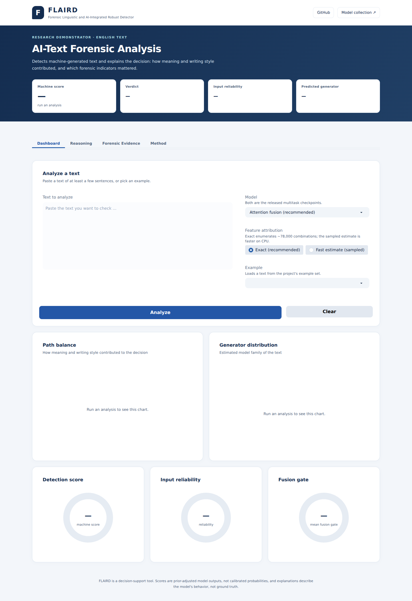

# Research dashboard and Space deployment

## 1. Interface and analysis flow

The [FLAIRD Space](https://huggingface.co/spaces/MahmoodAnaam/flaird) exposes the two released fine-tuned multitask checkpoints. The controller loads a selected model lazily and retains at most one checkpoint by default. The default choice is the proposed attention model; this is an architectural default, not a claim that it wins every benchmark.

| Tab | Purpose |
|---|---|
| Dashboard | Text/example input, model/method choice, verdict, baseline-relative path balance and generator distribution |
| Reasoning | Signed group waterfall, hierarchical feature view and attention-versus-contribution comparison |
| Forensic Evidence | Group contributions, ranked indicators and all 35 raw values/contributions |
| Method | Reading conventions and limitations |

The input cap is 30,000 characters; truncation is announced in a notice. The encoder independently reads at most 512 tokens. Exact feature attribution is the default; sampled Owen estimation is available for lower latency. Neither changes the initial model prediction.



## 2. Presentation changes

The interface uses a light masthead, navy research header, high-contrast white result tiles, neutral evidence panels, and a consistent spacing scale. Responsive rules keep cards stacked and navigation visible on small screens; large feature tables scroll inside their own container. Focus indicators and reduced-motion behavior are retained. Generator scores and the group waterfall use horizontal layouts with readable labels. A resize observer updates Plotly canvases when hidden tabs become visible or the viewport changes, preventing stale desktop-sized charts on phones.

All three application events—Analyze, Example and Clear—explicitly use `show_progress="hidden"`. There is no injected `gr.Progress` object or controller progress callback. This removes Gradio's progress overlays from every output, including plots and tables. Signed contribution bars remain because they encode results rather than loading progress. Error/validation notices remain visible after failed analyses. Space infrastructure may display its own startup or GPU allocation UI outside the application's control.

## 3. Local launch

```bash
python -m pip install -e .
python -m pip install spaces
python demo/app.py
```

The app uses `spaces.GPU` for the analysis function. Run it in an environment compatible with the checkpoint and dependencies; a complete model load requires Hub access and enough memory. UI tests can inject a controller to exercise the layout and event contract without downloading trained weights.

## 4. Existing publication mechanism

[`.github/workflows/sync-to-huggingface-hub.yml`](../.github/workflows/sync-to-huggingface-hub.yml) is triggered only through `workflow_dispatch`. It checks out the selected GitHub ref and invokes `huggingface/hub-sync@v0.3.0` with the configured target, repository type, privacy, SDK and subdirectory. The default target is `MahmoodAnaam/flaird`, type `space`, subdirectory `demo`, SDK `gradio`, and privacy **true**. Confirm the intended privacy when preparing a publication run; this documentation does not change it.

`demo/README.md` is the Space metadata card, specifying `app_file: app.py`, Python 3.12 and Gradio 6.27.0. `demo/requirements.txt` installs FLAIRD from the mutable GitHub `develop` branch. Therefore the synced demo files and imported package must correspond to a compatible `develop` revision. For a release record, retain the GitHub commit, workflow run and resolved package/model revisions.

To publish an approved change, merge the PR to `develop`, then manually dispatch the sync workflow on that ref with the intended target and privacy settings. A merge alone does **not** deploy the Space. The existing `HF_TOKEN` secret is consumed by Actions; it must not be copied into source files or reports. This review creates a PR and does not dispatch publication or alter deployed model weights.

## 5. Interpretation boundaries

“Path balance” compares baseline forensic input with observed forensic input in the hybrid model; it is not an independent semantic-only experiment. The mean gate summarizes a pre-projection mixture and does not express a percentage of final decision importance. Generator distributions are family estimates, and the binary score is uncalibrated. See [explanation theory](EXPLAINABILITY_MODULE.md), [features](FORENSIC_FEATURES.md), and [archived results](EVALUATION_RESULTS.md).
