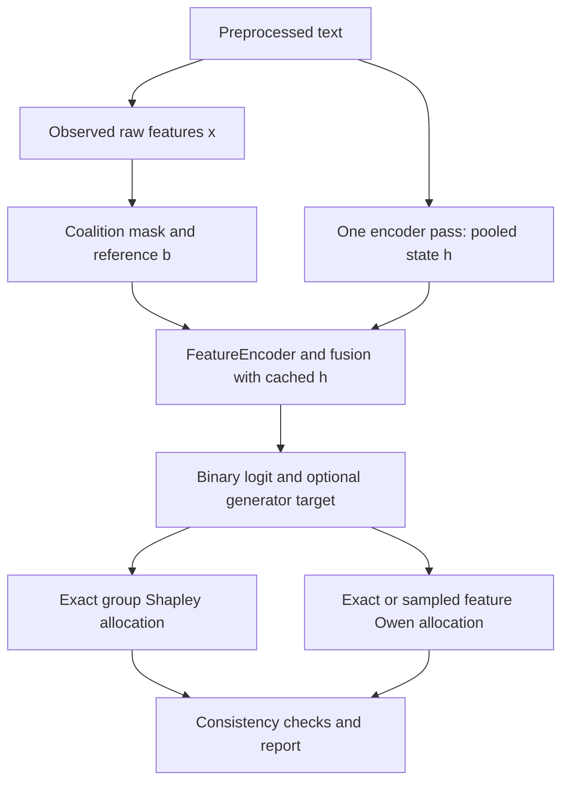

# Hierarchical explanation of FLAIRD predictions

## 1. Objective, scope and scientific status

FLAIRD's explanation module makes the numerical behavior of a trained detector inspectable. It explains the contribution of explicit linguistic features while holding the semantic representation fixed. It is a local explanation of a model computation, not an explanation of whether a claim is true, why an author wrote it, or whether a coordinated disinformation operation exists.

The implementation consists of [explain.py](../src/flaird/utils/explain.py), [the prediction CLI](../src/flaird/scripts/predict.py), and [the dashboard](../demo/app.py). The Space is already deployed; its publication mechanism is described in [DEMO.md](DEMO.md). Deployment establishes operational availability, not empirical validation of explanation faithfulness or calibrated uncertainty.

| Level | Analytical question | Implemented evidence |
|---|---|---|
| Input diagnostics | Are there obvious reasons for caution? | Length, token coverage, hidden characters, mixed scripts, whitespace and zero features |
| Decision | What score and family distribution were produced? | Binary sigmoid, verdict bands, optional generator softmax |
| Path decomposition | How does the forensic vector change the score relative to its reference? | Baseline logit and total forensic logit difference |
| Group explanation | Which linguistic families contribute to that difference? | Exact Shapley values for seven groups |
| Feature explanation | How is each group's effect allocated among its measurements? | Exact Owen values, or explicitly selected permutation estimates |
| Consistency | Does the accounting match the model output? | Forward equivalence, efficiency, group consistency, attention agreement |

## 2. The value function: what “removing evidence” means

For one preprocessed text, let $h$ be its pooled semantic state, $x\in\mathbb{R}^{35}$ its observed raw feature vector, $b$ a vector whose entries equal `baseline_value` (default zero), and $m\in\{0,1\}^{35}$ a keep mask. Construct

$$
x^{(m)}=m\odot x+(1-m)\odot b.
$$

The binary value function is

$$
v(m)=\operatorname{BinaryHead}\left(\operatorname{SharedHead}\left(\operatorname{Fusion}\left(h,\operatorname{FeatureEncoder}(x^{(m)})\right)\right)\right).
$$

It returns the **machine logit**, before sigmoid. The full mask retains all features, while the empty mask substitutes every raw feature. The encoder runs once during `explain`; masked evaluations reuse the cached pooled vector. This avoids tens of thousands of encoder passes. `explain_batch` is a sequential loop over documents rather than a batched encoder optimization.



This is a deterministic baseline-replacement game. It is not conditional SHAP over a background corpus, an average over population samples, or a text-editing counterfactual. Masked vectors can violate natural relationships between linguistic measurements. Keeping semantics fixed while altering style measurements can create an input pair that no real text could produce.

### 2.1 Why use logits?

Logits provide the additive scale used by the attribution accounting. The displayed score is $s=\sigma(v(\mathbf{1}))$. Because sigmoid is nonlinear, a contribution of +0.5 logit does not mean +50 percentage points. Its score effect depends on the starting logit. Generator attributions use a different scalar:

$$
v_c(m)=z_c(m)-\log\sum_{j\ne c}\exp(z_j(m))
       =\log\frac{p_c(m)}{1-p_c(m)}.
$$

This is one class versus all other generator classes. A positive generator attribution supports the **selected family target**, not necessarily machine authorship. Binary and generator targets share fusion/head evaluations for each mask.

## 3. Shapley values: fair allocation among feature groups

A cooperative game treats each feature group as a “player.” A coalition is a subset of groups whose observed values are retained. Let $\mathcal{G}=\{1,\ldots,7\}$ and $U(S)$ be all feature indices belonging to groups in $S$. Write $V(S)=v(\mathbf{1}_{U(S)})$.

The Shapley value of group $k$ averages its marginal effect over every possible position in an ordering of groups:

$$
\Phi_k=\sum_{S\subseteq\mathcal{G}\setminus\{k\}}
\frac{|S|!(7-|S|-1)!}{7!}
\left[V(S\cup\{k\})-V(S)\right].
$$

Each difference asks: “With these other groups already present, how much does adding group $k$ change the logit?” Averaging avoids attributing all interaction effects to whichever group happens to be added last. The familiar properties are efficiency, symmetry, null-player behavior and linearity. Efficiency in this baseline game is

$$
\sum_{k=1}^{7}\Phi_k=V(\mathcal{G})-V(\varnothing).
$$

Positive values move the model toward machine; negative values move it toward human. A negative contribution can occur in an overall machine prediction and vice versa. The method explains a difference from a reference, rather than labeling individual features as intrinsically human or artificial.

### 3.1 Worked two-group example

The following is a hypothetical arithmetic example, **not a measured FLAIRD output**:

| Retained groups | Logit |
|---|---:|
| None | -1.0 |
| Lexical only | 0.2 |
| Punctuation only | -0.6 |
| Both | 1.0 |

Lexical contribution is $\frac12[(0.2+1.0)+(1.0+0.6)]=1.4$. Punctuation contribution is $\frac12[(-0.6+1.0)+(1.0-0.2)]=0.6$. Their sum is 2.0, matching $1.0-(-1.0)$. The final score is sigmoid(1.0), approximately 0.731. Assigning the last-added effect alone would give different answers depending on ordering; Shapley averages both orders.

## 4. Owen values: consistent allocation inside groups

Ordinary feature Shapley values would permit all 35 measurements to enter in any order. FLAIRD instead preserves the seven linguistic groups. Owen's coalition-structure value averages only over orders in which each group's features remain contiguous: first order the groups, then order features within each group.

For feature $i$ in group $G_k$ with size $g_k$, define $w_n(s)=s!(n-s-1)!/n!$. Its Owen value is

$$
\phi_i=\sum_{S\subseteq\mathcal{G}\setminus\{k\}}w_7(|S|)
\sum_{T\subseteq G_k\setminus\{i\}}w_{g_k}(|T|)
\left[v\!\left(\mathbf{1}_{U(S)\cup T\cup\{i\}}\right)-
v\!\left(\mathbf{1}_{U(S)\cup T}\right)\right].
$$

In exact arithmetic, the method provides both levels of accounting:

$$
\sum_{i\in G_k}\phi_i=\Phi_k,\qquad
\sum_{i=1}^{35}\phi_i=v(\mathbf{1})-v(\mathbf{0}).
$$

The grouping therefore has a substantive role: it defines how cross-group interactions are shared. Owen values are not merely ordinary feature Shapley values displayed under headings. Changing the partition changes the estimand.

**Illustration.** If a group has Shapley contribution +0.8, feature Owen values +0.7, +0.4 and -0.3 sum to that group contribution. The negative feature counteracts the others. In a sunburst sized by absolute feature contributions, this group occupies 1.4 units of area, not 0.8, because opposing contributions cancel only in the signed sum.

### 4.1 Why this method was selected

The explanation hierarchy matches FeatureEncoder's seven group tokens. Exact group values require only $2^7=128$ group coalitions. Enumerating all $2^{35}=34,359,738,368$ feature masks for unrestricted feature Shapley would be much more costly. Exact Owen only needs a union of whole groups plus a partial subset of one group. Gradient methods are possible alternatives, but would answer a path-dependent attribution question and require a separate validation protocol. The current choice provides explicit, finite coalition accounting that can be checked numerically.

For group sizes $(10,7,5,4,5,2,2)$, the number of distinct masks evaluated is

$$
M=2^7+2^6\sum_{k=1}^{7}(2^{g_k}-2)=78{,}592.
$$

Masks use `uint64`; the engine supports at most 63 feature positions. Values are evaluated in chunks of 4,096 by default; attribution accumulation uses NumPy float64, although network inference uses the checkpoint's tensor dtype. “Exact” refers to coalition enumeration, not infinite numerical precision or causal validity.

### 4.2 Sampled Owen estimation

`owen_method="permutation"` selects an antithetic estimator, with 512 requested orders and seed 13 by default. Each sampled group-contiguous ordering is paired with its reverse. Standard errors are computed from **pair means**, accounting for that pairing. The effective order count is `2 * max(1, requested // 2)`; an odd requested number is rounded down to an even number, subject to the minimum of two.

Group Shapley values remain exact in this mode because all 128 group coalitions are also evaluated. Feature values are approximate. Their total remains efficient up to floating-point error because each path telescopes, but their sums inside individual groups need **not** equal the exact group values for a finite sample. The `owen_group_consistency_error` can therefore be nonzero without an implementation failure. Report the method, actual permutations, seed and feature standard errors whenever using sampled results academically.

The implementation does not silently fall back to sampling. If exact evaluation exceeds `max_exact_evaluations` (600,000 by default), it raises an informative error. Runtime depends on checkpoint width, hardware, dtype and method; no unverified latency benchmark is claimed here.

## 5. Reference input and path decomposition

The default raw baseline is zero. This is computationally reproducible without a reference dataset and remains zero under the sign-log transform. It is **not** the average human text or an empirically neutral writing style. Learned projection biases and LayerNorm parameters may produce nonzero feature tokens even for zero raw input.

The returned path balance is

$$
z_0=v(\mathbf{0}),\qquad \Delta_F=v(\mathbf{1})-v(\mathbf{0}),\qquad
z=z_0+\Delta_F.
$$

`semantic_logit` is the historical field name for $z_0$. Precisely, it is the **full hybrid model with baseline forensic inputs**, not an independently trained semantic-only model. Interactions with the fixed semantic state are allocated to the forensic difference. This is a one-sided, semantic-anchored decomposition.

The dashboard's two “shares” are magnitude summaries:

$$
r_S=\frac{|z_0|}{|z_0|+|\Delta_F|},\qquad r_F=1-r_S.
$$

If the denominator is zero, both are 0.5 by convention. These are neither probabilities nor percentages of causal responsibility. For example, $z_0=-3$ and $\Delta_F=+4$ yield final logit +1, but magnitude shares $3/7$ and $4/7$. Opposing paths cancel in the final logit.

`counterfactual_logit(text, removed_groups)` substitutes selected feature groups while keeping cached semantics for that call. It reruns the original encoder once per API call; it does not generate or edit a text. Removing top-attributed groups need not always outperform a random removal, because interaction effects depend on the coalition. Numerical additivity alone is not an empirical faithfulness test.

## 6. Decision and reliability conventions

The binary score is affected by the weighted training objective (`pos_weight` approximately 0.03117). “Prior-adjusted” in the UI refers to this training reweighting; no separate post-hoc prior correction or calibration model is applied. It should not be presented as a calibrated probability that a document was generated.

| Output | Rule | Interpretation |
|---|---|---|
| `prediction_at_0_5` | Score ≥ 0.5 | Binary explainer decision; evaluator uses strict > 0.5 |
| Likely human-written | Score ≤ 0.35 | Presentation band, not validated coverage |
| Inconclusive | 0.35 < score < 0.65 | UI uncertainty band, not evaluator abstention |
| Likely machine-generated | Score ≥ 0.65 | Presentation band |
| Head consistency | Absolute difference between `1-p_human` and machine score ≤ 0.25 | Heuristic agreement, not external validation |

Generator probabilities are softmax outputs over the supported classes. The human class participates in this auxiliary task. Top-three classes, entropy (natural logarithms), and the consistency heuristic are reported. There is no unknown-generator class.

Input reliability is **low** for fewer than 30 regex words or an all-zero feature vector. Otherwise it is **medium** if encoder coverage is below 50%, zero-width characters exist, words mix Unicode name-prefix script categories, or unusual whitespace affects more than 5% of whitespace runs. It is **high** otherwise. Truncation can produce a warning even when the reliability category remains high. These are deterministic heuristics rather than statistically calibrated confidence levels. Mixed-script detection does not cover every homoglyph attack, and partial feature failures may escape the all-zero check.

## 7. API, CLI and output schema

```python
from flaird.utils.explain import ExplainConfig, FlairdExplainer, explain_to_markdown

explainer = FlairdExplainer.from_pretrained(
    'MahmoodAnaam/flaird-modernbert-large-attention-multitask',
    ExplainConfig(owen_method='exact'),
)
result = explainer.explain('A sufficiently long English document to analyze ...')
print(explain_to_markdown(result))
payload = result.to_dict()
print(payload['checks'])
# Optional on a multitask checkpoint:
family_result = explainer.explain('Another English document ...', generator_target='GPT')
```

```bash
flaird-predict --text "A sufficiently long English text ..." --report
flaird-predict --input essay.txt --output explanation.json --report
flaird-predict --input documents.jsonl --output explanations.jsonl
flaird-predict --text "An English document ..." --owen-method permutation --owen-permutations 512
```

Each JSONL input line needs a `text` field. A text file yields one JSON object; JSONL input yields one explanation per line. Model loading uses Auto classes with `trust_remote_code=True`. Use reviewed checkpoint code in a controlled environment.

| Field | Content |
|---|---|
| `meta` | Model ID, fusion capabilities, explanation configuration, timings and notes |
| `input` | Counts, truncation, heuristic reliability and warnings |
| `decision` | Logit, sigmoid score, threshold result and verdict |
| `generator` | Optional family distribution and head agreement |
| `balance` | Baseline logit, forensic delta, final logit, magnitudes and gate |
| `groups`, `features` | Signed contributions, observed feature values, direction and rank |
| `generator_attribution` | Optional target-specific group/feature allocations in family log-odds |
| `checks` | Numerical errors and optional attention/contribution rank correlation |
| `attribution` | Method, evaluation count, baseline, target and actual permutations |

Serialization rounds floating values to six decimal places and converts nonfinite values to JSON null. Tiny contributions can disappear at this precision. Concatenation reports no attention/gate; single-task checkpoints report no generator analysis. These absent capabilities are represented explicitly, rather than invented from another model.

## 8. Validation and interpretation protocol

For a research report, retain the checkpoint revision, package versions, original text, preprocessing choice, baseline, dtype/device, method and complete JSON. Examine `value_function_error` before interpreting attributions: cached-state reconstruction should match the original forward. Inspect feature/global efficiency and, for exact Owen, group consistency. Lower-precision inference can increase these residuals; choose tolerances appropriate to the runtime and report them.

Then compare signed effects across reasonable baselines, repeat sampled estimation with more permutations, and inspect whether conclusions are stable. A reference sensitivity study is a recommended **additional experiment**, not a completed result in the archived benchmark files. Likewise, the repository's TIRA/RAID detection scores do not validate explanation quality, and no real-checkpoint explanation benchmark is inferred from those scores.

Attention/contribution Spearman correlation compares head-averaged group attention with absolute group Shapley values. A high correlation indicates agreement between two summaries; it does not establish correctness. A low correlation can reflect nonlinear downstream processing, cancellation or interactions. Attention is a routing diagnostic and must not be equated with the signed masking attribution.

The historical documentation referred to a `verify_explain.py` script, a CLI and a 35-test suite that were absent from the reviewed baseline. Those unsupported claims are removed. The current release's actual verification and limitations are recorded in [RELEASE_REVIEW.md](RELEASE_REVIEW.md).

## 9. Primary references

- Shapley, L. S. (1953). *A Value for n-Person Games*. In *Contributions to the Theory of Games II*, pp. 307–317. [Publisher DOI](https://doi.org/10.1515/9781400881970-018).
- Owen, G. (1977). *Values of Games with a Priori Unions*. In *Mathematical Economics and Game Theory*, pp. 76–88. [Publisher DOI](https://doi.org/10.1007/978-3-642-45494-3_7).
- Lundberg, S. M., and Lee, S.-I. (2017). *A Unified Approach to Interpreting Model Predictions*. [Paper](https://arxiv.org/abs/1705.07874). FLAIRD implements its own structured game; it does not call the SHAP package.
- Jain, S., and Wallace, B. C. (2019). *Attention is not Explanation*. [ACL Anthology](https://aclanthology.org/N19-1357/).
- Wiegreffe, S., and Pinter, Y. (2019). *Attention is not not Explanation*. [ACL Anthology](https://aclanthology.org/D19-1002/). Together these motivate explicit validation rather than treating attention as self-validating evidence.
