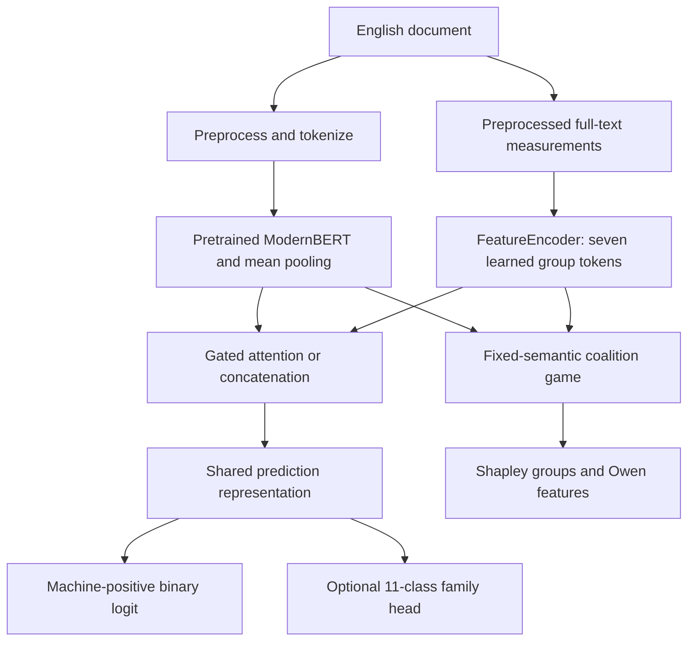

# Master's thesis research proposal and implementation-grounded specification

## 1. Thesis title

**Forensic Linguistics and AI for the Detection of Machine-Generated Disinformation Campaigns**

**System:** FLAIRD — Forensic Linguistic and AI-Integrated Robust Detector.

**Scope clarification:** The implemented and evaluated task is English document-level machine-generated text detection, with auxiliary generator-family classification. It is a potential component of disinformation investigation; it does not directly classify factual falsehood, intention to deceive, or coordinated campaign activity. The title's broader motivation must be distinguished from the measured research construct throughout the thesis.

## 2. Abstract

The increasing fluency and accessibility of large language models creates a practical need for methods that can identify generated text while exposing the computational basis of their decisions. Text origin and disinformation are distinct concepts: human writing can be false, and generated writing can be accurate. Accordingly, this thesis operationalizes its contribution as an English text-origin detector intended to support, rather than replace, broader forensic investigation.

FLAIRD integrates a pretrained ModernBERT-large encoder with 35 explicit linguistic measurements arranged into seven groups. Group-specific FeatureEncoder projections convert heterogeneous scalar measurements into a sequence of learned feature tokens. A document-level gated cross-attention module retrieves linguistic evidence conditioned on pooled semantic context, combines it with a gated mixture and multiplicative interaction, and supports a shared binary/generator-family prediction head. A concatenation-based fusion alternative provides a matched architectural comparator. Eight completed configurations vary fusion, encoder freezing and auxiliary supervision under a one-epoch training recipe.

The prepared corpus combines PAN26 partitions with a binary-stratified 90/10 row split of RAID's labeled source: saved notebook outputs record 5,077,945 training and 565,171 validation documents. Archived TIRA results cover PAN25, PAN26, Eloquent and a smoke set; one RAID artifact provides controlled-false-positive and attack-level evaluation. Results are conditional: fine-tuned attention multitask leads concatenation multitask on PAN25 composite Mean (0.958 versus 0.951), whereas concatenation leads on PAN26 (0.894 versus 0.836). These observations motivate analysis of optimization requirements, transfer and calibration rather than a universal superiority claim.

A hierarchical explanation module assigns exact Shapley values to the seven feature groups and exact Owen values to individual measurements, relative to a fixed baseline and cached semantic state. A reproducible CLI and deployed research dashboard expose scores, diagnostics and contributions. The thesis will distinguish computational consistency from empirical explanation validity, acknowledge unaudited source overlap in the internal row split, and avoid interpreting generated-text detection as proof of deception or authorship.

## 3. Background and research context

Language models can produce persuasive articles, essays, reviews and short-form messages at scale. This capability lowers the cost of legitimate drafting and also enables synthetic content in misleading information environments. A detector can contribute evidence about probable generation patterns, but document provenance remains only one element of a responsible investigation.

Contextual encoders learn high-dimensional representations that can support strong classification but may obscure the role of observable writing characteristics. Classical stylometric measurements expose vocabulary concentration, function-word habits, surface formatting and structural variation, but can be sensitive to length, genre and preprocessing. A hybrid model is motivated by the possibility that these streams provide complementary representations, not by an assumption that either stream is intrinsically reliable.

The RAID benchmark demonstrates why evaluation must consider generators, decoding and attack conditions rather than reporting only a favorable aggregate [1]. Attention mechanisms enable input-adaptive evidence routing [2], but attention weights alone do not establish an explanation of the model's output [4,5]. Cooperative-game allocation provides a mathematically specified alternative for assigning a model-output difference across grouped measurements [6–8].

## 4. Problem statement

The research problem is to determine how contextual neural representations and interpretable stylistic measurements can be integrated and evaluated for English machine-generated text detection, while exposing their local contribution structure and documenting the limits of generalization.

Four difficulties shape this problem. First, classifiers can exploit dataset-specific regularities instead of transferable generator characteristics. Second, a complex fusion module may require different optimization conditions from a simpler comparator. Third, a high score can be mistaken for calibrated confidence, especially under severe class imbalance. Fourth, an apparently coherent explanation can accurately describe model arithmetic while remaining sensitive to arbitrary reference inputs or unrealistic perturbations.

The study therefore needs architecture-grounded explanations, matched comparisons, traceable benchmark evidence and explicit separation of observation, hypothesis and untested extension.

## 5. Aim and research objectives

The aim is to design, implement and critically evaluate an interpretable hybrid English text-origin detector as a component of computational forensic analysis.

1. Define a reproducible preprocessing, label and feature contract for combining PAN26 and RAID-derived training data.
2. Integrate pretrained semantic states with seven groups of 35 stylistic measurements using gated cross-attention.
3. Compare attention and concatenation fusion under single-task/multitask and frozen/fine-tuned settings.
4. Assess benchmark performance using ranking, thresholded and probability-sensitive metrics, with attack-level analysis where archived evidence exists.
5. Produce hierarchical group/feature attribution with a precisely defined masking baseline and numerical consistency checks.
6. Deliver a usable demonstration and technical documentation that expose uncertainty and methodological limitations.
7. Distinguish the implemented text-origin task from future factuality, campaign and multilingual extensions.

Objectives 1–6 have implementation artifacts and completed detector experiments. Additional multi-seed, source-disjoint, calibration and explanation-sensitivity studies below are proposed extensions; they are not presented as already completed.

## 6. Research questions and hypotheses

| Research question | Falsifiable hypothesis | Current evidence and boundary |
|---|---|---|
| RQ1: Does gated attention improve over concatenation? | H1: Attention improves held-out detection under matched data and optimization. | Mixed across benchmarks; PAN25 supports an advantage, PAN26 multitask does not. No universal confirmation. |
| RQ2: Does generator-family supervision improve binary detection? | H2: Multitask representations improve detection over corresponding binary-only models. | Several improvements, especially fine-tuned PAN26; counterexamples exist. |
| RQ3: What is the effect of encoder adaptation? | H3: Fine-tuning improves transfer over freezing. | Generally beneficial, but conditional; batch and selection differences limit isolation. |
| RQ4: Can local forensic contributions be accounted for coherently? | H4: Exact structured attribution satisfies forward equivalence, efficiency and group consistency within numerical tolerance. | Mathematical/implementation property to verify computationally; not an assertion of human-valid explanations. |
| RQ5: Does a larger optimization budget benefit attention more? | H5: Matched longer training improves attention's relative PAN26 performance. | Plausible explanation of current ordering; no completed longer-budget comparison. |
| RQ6: How stable are explanations under baseline/estimator choices? | H6: Dominant signed evidence remains stable across reasonable references and sufficient sampling. | Requires additional sensitivity analysis; archived detection results cannot answer it. |

These hypotheses must remain revisable. A thesis should report negative and mixed outcomes rather than redefine success after seeing results.

## 7. Significance and intended contributions

The architectural contribution is a specific integration of document-level semantics and grouped forensic features, together with a factorial comparison against a simpler learned fusion. The explanation contribution is a local hierarchical allocation whose group and individual values share a defined coalition structure. The engineering contribution is a reproducible package, inference interfaces and a deployed dashboard with evidence-oriented presentation.

The study does not claim that multihead attention, stylometry, Shapley values or Owen values are individually novel. Novelty should be assessed in their particular combination, evaluation and transparent operational specification, with comparison to the relevant literature. Practical beneficiaries include researchers and analysts who need inspectable text-origin signals, subject to appropriate domain validation.

## 8. Proposed and implemented system architecture

ModernBERT provides contextual token states; masked mean pooling produces one document vector. FeatureEncoder applies a sign-preserving logarithm, then one learned linear/GELU/LayerNorm/dropout projection per group to produce seven 128-dimensional feature tokens. Its purpose is to reconcile scale and encode within-group relationships while retaining group identity.

The attention path uses the normalized document vector as a **single query** and group tokens as keys/values in eight-head cross-attention. A vector gate mixes semantic state and retrieved forensic context. Their elementwise product supplies an explicit interaction channel before projection to the shared prediction space. This is group-level evidence retrieval, not token-level attention explanation. The concatenation comparator averages the same group tokens, concatenates that mean with pooled semantics and projects it nonlinearly.

The binary head outputs one machine-positive logit. The optional auxiliary head classifies GPT, Meta-LLaMA, MPT, Cohere, Mistral, Gemini, DeepSeek, Falcon, Bison, Qwen or human. It learns dataset-defined family signatures rather than verified exact authorship. Detailed equations, dimensions and component-removal implications are provided in [ARCHITECTURE.md](ARCHITECTURE.md).

## 9. Methodology

### 9.1 Research design and completed comparisons

The empirical design has three two-level factors: fusion, encoder freezing and auxiliary supervision, producing eight completed runs. Configurations use the same prepared corpus, nominal learning rate and one epoch. This supports controlled descriptive comparisons within a factor, but is not perfectly matched in optimization budget: frozen runs use batch 256 and fine-tuned runs 128; one frozen single-task configuration omits best-model restoration.

The methodological position is artifact-grounded and reproducibility-oriented. Committed source defines implemented behavior; JSON files define run settings; notebook outputs define recorded preparation observations; benchmark JSON files define archived metrics. A missing output is marked unavailable instead of being inferred from a code cell's intent.

### 9.2 Data collection and partitioning

PAN26 provides 23,707 training and 3,589 validation rows. RAID's labeled source has 5,615,820 rows and is split 90/10 by binary label with seed 42. Combining the corresponding partitions produces 5,077,945 training and 565,171 validation rows. The separate 672,000-row unlabeled RAID test is used for submission inference.

This is a **row-stratified internal validation** design. The notebook drops source identifiers before the split and does not perform a recorded near-duplicate audit. Attack variants or related source documents may cross partitions; source-disjoint generalization cannot be inferred from internal validation alone. A future source-group split would require a new experimental series, not a retroactive relabeling of the completed results.

### 9.3 Preprocessing and class handling

Email, mention and phone-like patterns are replaced by placeholders, while stylistic evidence is otherwise retained subject to the extractor's numerical conventions. Binary labels are human 0 and machine 1. Prepared rows contain a 35-value ordered feature vector and an integer family label. Machine texts constitute approximately 96.98% of training rows; loss weighting addresses the imbalance without resampling.

The existing TIRA path preprocesses tokenization input but extracts on-demand features from raw text, whereas training and the explainer use preprocessed feature input. This discrepancy is documented and preserved to maintain the meaning of archived checkpoints and scores. Full provenance and the cell audit appear in [DATASET_PREPARATION.md](DATASET_PREPARATION.md).

## 10. Feature engineering

The implemented groups are lexical diversity (10), function-word style (7), surface composition (5), structural organization (4), punctuation/rhetoric (5), information entropy (2) and repetition/burstiness (2). The features are deterministic measurements with library-dependent tokenization and chunk summaries. They do not include parser-based syntactic complexity, discourse coherence or readability scores.

Some measures overlap statistically. For example, TTR, hapax ratios and Yule measures all depend on vocabulary counts; different denominators and nonlinear mappings expose complementary views but do not create independent evidence. Word burstiness is a CV of type frequencies, not a temporal clustering statistic. Bigram entropy describes an empirical pair distribution, not a model likelihood. These distinctions protect the thesis from attributing linguistic constructs that the code does not measure.

[FORENSIC_FEATURES.md](FORENSIC_FEATURES.md) defines every index, denominator, example, failure convention and model transformation. An undefined library statistic can be converted to zero, so feature absence and extraction failure are not always distinguishable.

## 11. Training and loss formulation

The pretrained encoder is combined with newly initialized feature/fusion/prediction layers. Frozen variants disable encoder gradients; fine-tuned variants update the encoder as well. Main runs use AdamW fused, learning rate $2\times10^{-5}$, cosine scheduling, approximately 6% warmup under Transformers 5.16.1, weight decay 0.01, seed 42, bf16 and a maximum input length of 512 tokens.

For binary logit $z_i$, label $y_i$, positive weight $w_+=0.0311727005543984$ and batch size $B$:

$$
\mathcal{L}_{\mathrm{bin}}=-\frac1B\sum_i
\left[w_+y_i\log\sigma(z_i)+(1-y_i)\log(1-\sigma(z_i))\right].
$$

For auxiliary softmax $p_{i,c}$, class weights $a_c$ and true family $c_i$:

$$
\mathcal{L}_{\mathrm{gen}}=-\frac{\sum_i a_{c_i}\log p_{i,c_i}}{\sum_i a_{c_i}},
\qquad
\mathcal{L}=\mathcal{L}_{\mathrm{bin}}+\lambda\mathcal{L}_{\mathrm{gen}}.
$$

Multitask runs use $\lambda=0.2$; single-task runs disable the auxiliary head and term. The weight changes score semantics, so a sigmoid should not be equated with a calibrated posterior. Seven configurations restore minimum-validation-loss checkpoints; the exception and all run-specific settings are recorded in [TRAINING_CONFIGURATION.md](TRAINING_CONFIGURATION.md).

## 12. Explanation methodology

The explanation holds the pooled semantic vector fixed, replaces omitted raw features with baseline zero and measures the resulting machine logit. Exact Shapley group values average marginal effects over all group coalitions. Owen values extend the same logic to features under group-contiguous orderings. Their exact sums recover both the group contributions and total forensic difference.

The resulting accounting is

$$
v(\mathbf{1})=v(\mathbf{0})+\sum_{k=1}^{7}\Phi_k,
\qquad \Phi_k=\sum_{i\in G_k}\phi_i.
$$

Here $v(\mathbf{0})$ is the hybrid network at baseline forensic input, not a separate semantic-only detector. Learned biases can keep feature tokens nonzero. These explanations are baseline-relative model effects, not causal effects on real authorship. Counterfactual vectors need not correspond to a realizable text.

Exact evaluation uses 78,592 distinct masks with one encoder pass per document. A faster, explicitly selected antithetic permutation estimator approximates feature Owen values, retains exact group Shapley values and reports feature standard errors. Finite-sample group consistency is not guaranteed in that mode. The dashboard also shows attention and gate diagnostics, which are not interpreted as causal shares. [EXPLAINABILITY_MODULE.md](EXPLAINABILITY_MODULE.md) provides derivations, worked examples and interpretation limits.

## 13. Evaluation protocol and completed observations

TIRA summaries report ROC-AUC, complemented Brier score, c@1, machine-positive F1, F0.5u and their composite Mean. The comparator threshold is strict > 0.5; exact 0.5 is an abstention in the relevant metrics. The dashboard's broader inconclusive band has no role in those archived formulas.

| Fine-tuned multitask model | PAN25 Mean | PAN26 Mean | Eloquent Mean | Smoke Mean |
|---|---:|---:|---:|---:|
| Gated attention | 0.958 | 0.836 | 0.776 | 0.978 |
| Concatenation | 0.951 | 0.894 | 0.774 | 0.978 |

These values establish conditional rather than universal superiority. On Eloquent, attention has stronger ranking but weaker thresholded F1 than concatenation. On PAN26, concatenation's advantage spans several metrics and merits investigation. Frozen multitask attention exceeds frozen concatenation on all four composites, showing that attention remains useful in other settings. Full tables for all eight runs appear in [EVALUATION_RESULTS.md](EVALUATION_RESULTS.md).

The archived RAID attention-multitask aggregate has AUROC 0.998726 and TPR 0.997678 at 5% FPR, or 0.990006 at 1% FPR. The nested `accuracy` field is a detection rate over machine cases, not overall accuracy. At 1% FPR, paraphrase and zero-width-space conditions fall to approximately 0.961 and 0.960. Other models have no RAID result artifact in the reviewed repository, so no cross-model RAID ranking is claimed.

## 14. Discussion and competing explanations

Attention fusion learns more newly initialized transformations than concatenation. A fixed one-epoch schedule may therefore leave its fusion/gating pathway insufficiently optimized even when the pretrained encoder is strong. Attention's advantages on PAN25 and several frozen comparisons make this a plausible explanation for its PAN26 deficit.

This remains a hypothesis. Concatenation also trains several layers from scratch; it is not an entirely pretrained alternative. Domain shift, auxiliary-task interference, different operating-point calibration, checkpoint selection and initialization variability are competing explanations. The available summaries contain neither matched learning curves nor multiple seeds sufficient to distinguish them. Longer training must be tested, rather than asserted to repair the result.

A proposed extension would compare matched update budgets, separate fusion/encoder learning rates, multiple seeds and validation-based early stopping. It should preserve held-out test isolation and assess whether gains survive source-disjoint validation. Baseline sensitivity and human interpretation studies would evaluate explanations separately from detection accuracy. These are research recommendations, not promised measurements in the completed release.

## 15. Validity, ethics and limitations

**Construct validity:** Text generation is not factuality, deception or coordination. The thesis must not convert origin scores into disinformation labels without separately annotated evidence.

**Internal validity:** Related-source leakage has not been audited; one seed and unequal frozen/fine-tuned batch sizes constrain causal interpretations of comparisons. Library versions and private dataset revisions are not fully recorded in notebooks.

**External validity:** Results apply to the archived English benchmarks, not arbitrary languages, future generators, very short texts or novel evasion techniques. Unknown generators can be forced into an existing auxiliary class.

**Explanation validity:** Exact arithmetic allocation does not establish the realism of masked inputs, baseline neutrality, human usefulness or correctness of the prediction. Features are correlated and reference-sensitive.

**Operational ethics:** Scores are decision support. Consequential accusations require independent evidence, a meaningful appeal process and domain-appropriate error analysis. Input text may contain personal information; placeholder substitution is not a comprehensive privacy guarantee. The system has no implemented identity verification or campaign-network evidence module.

## 16. Deliverables and research status

| Deliverable | Status / evidence |
|---|---|
| Hybrid architecture and eight configurations | Implemented in source and JSON configs |
| Prepared corpus and feature pipeline | Saved preparation outputs; publication calls lack saved success confirmations |
| Eight detector experiments | Completed per project status; 32 archived TIRA dataset-run records |
| RAID attack-aware evaluation | One archived attention-multitask result file |
| Hierarchical explanation, CLI and Space | Implemented and deployed per project status |
| Technical specification and thesis-grounded documentation | This documentation set |
| Multi-seed, longer-budget, source-disjoint retraining | Proposed additional research, not completed evidence |
| Factuality, coordination, multilingual modeling | Outside current implementation |

The implementation and benchmark phase is complete. Thesis writing should now consolidate methodology, preserve the mixed findings, discuss limitations, and cite the exact artifacts. No fabricated calendar or retroactive experimental history is introduced.

## 17. Conclusion

FLAIRD provides an implemented hybrid text-origin detector with a defined linguistic feature contract, two fusion strategies, auxiliary family supervision and hierarchical explanations. Its empirical contribution is the documented pattern of strengths and failures across completed comparisons, not a claim that complexity always wins. The architecture and explanation methods support a defensible thesis when results, assumptions and application scope remain clearly separated.

## 18. References

1. Dugan et al. (2024). *RAID: A Shared Benchmark for Robust Evaluation of Machine-Generated Text Detectors*. [ACL](https://aclanthology.org/2024.acl-long.674/).
2. Vaswani et al. (2017). *Attention Is All You Need*. [Paper](https://arxiv.org/abs/1706.03762).
3. Warner et al. *Smarter, Better, Faster, Longer: A Modern Bidirectional Encoder for Fast, Memory Efficient, and Long Context Finetuning and Inference*. [Paper](https://arxiv.org/abs/2412.13663).
4. Jain and Wallace (2019). *Attention is not Explanation*. [ACL](https://aclanthology.org/N19-1357/).
5. Wiegreffe and Pinter (2019). *Attention is not not Explanation*. [ACL](https://aclanthology.org/D19-1002/).
6. Shapley (1953). *A Value for n-Person Games*. In *Contributions to the Theory of Games II*, 307–317. [DOI](https://doi.org/10.1515/9781400881970-018).
7. Owen (1977). *Values of Games with a Priori Unions*. In *Mathematical Economics and Game Theory*, 76–88. [DOI](https://doi.org/10.1007/978-3-642-45494-3_7).
8. Lundberg and Lee (2017). *A Unified Approach to Interpreting Model Predictions*. [Paper](https://arxiv.org/abs/1705.07874).
9. Trim. *pystylometry*, implementation reference. [Repository](https://github.com/craigtrim/pystylometry), with checked numerical conventions from version 1.4.3.
