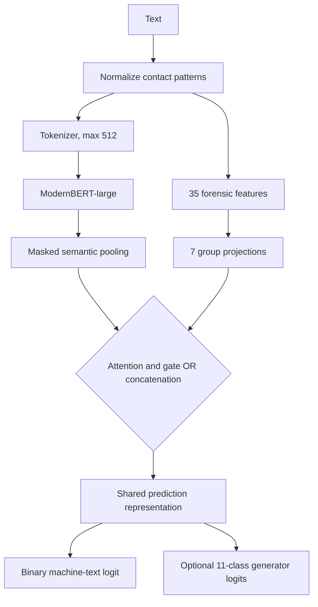

# Master’s Thesis 

## 1.Thesis Title

**Forensic Linguistics and AI for the Detection of Machine-Generated Disinformation Campaigns**

## 2. Abstract

Large language models can generate fluent English across many genres, making machine-generated text difficult to distinguish from human writing by surface inspection alone. This thesis presents **FLAIRD (Forensic Linguistic and AI-Integrated Robust Detector)**, an English-focused detector that combines ModernBERT-large contextual states with 35 deterministic forensic-linguistic measurements. The implementation supports attention-and-gate fusion and a concatenation baseline, and compares binary-only training with an auxiliary 11-class generator-family objective.

Eight configurations were trained and evaluated. On the saved PAN26 TIRA test results, the trainable concatenation multi-task model reached a mean score of 0.894, while the trainable attention multi-task model reached 0.836. The attention multi-task checkpoint also has a RAID leaderboard aggregate AUROC of 0.998726 in the committed results artifact. These are benchmark-specific observations, not guarantees of performance on unseen text. Evaluation definitions, all eight PAN26 rows, RAID operating statistics, and caveats are documented in [evaluation-results.md](evaluation-results.md).

FLAIRD is intended as a research decision-support system, not an authorship oracle. Its feature attributions and fusion attention expose model behavior but do not prove causality or authorship. The system is English-focused; Arabic and broader multilingual detection remain future work.

## 3. Introduction

Large language models have changed the modern information environment. They can generate news-style articles, opinion pieces, social-media posts, educational explanations, and persuasive arguments that closely resemble human writing. This ability becomes risky when it is used to produce disinformation at scale.

Machine-generated disinformation is difficult to detect for three main reasons. First, generated text can be grammatically correct and semantically coherent. Second, a malicious actor can quickly create many variations of the same message across different domains and styles. Third, modern models can imitate human-like tone, structure, and argumentation, making simple rule-based detection insufficient.

Existing detection methods have important limitations. Purely neural detectors may achieve high performance in controlled settings, but they are often difficult to interpret and may fail when tested on unseen domains or generators. Feature-based forensic linguistic systems provide clearer evidence, but they may not capture deeper semantic patterns learned by modern language models.

This work implements a hybrid approach that combines neural semantic representations with forensic-linguistic evidence and evaluates both binary detection and generator-family prediction.

## 4. Problem Statement

The core problem is that machine-generated English disinformation text is increasingly difficult to distinguish from human-written text, especially when it is persuasive, polished, paraphrased, or produced by different model families.

Current detectors face four major challenges:

1. **Limited interpretability:** many detectors output only a probability score without explaining the linguistic evidence behind the decision.
2. **Weak generalization:** detectors trained on one domain or generator may perform poorly on unseen domains or model families.
3. **Insufficient forensic grounding:** many systems do not use explicit linguistic features that support academic or investigative reasoning.
4. **Limited use of generator information:** binary labels ignore the fact that different models may produce different linguistic signatures.

This thesis addresses these challenges by proposing an interpretable hybrid architecture with binary classification and multi-class generator prediction.

## 5. Research Aim

The aim of this thesis is to design, implement, and evaluate an English-language hybrid AI system for detecting machine-generated disinformation text by integrating Transformer-based semantic modeling, forensic linguistic features, and supervised multi-task learning.

## 6. Research Objectives

The objectives are:

1. Build an English text preparation pipeline using the documented PAN 2026 and RAID training data while keeping evaluation data separate.
2. Extract and encode 35 forensic-linguistic indicators in seven interpretable groups.
3. Integrate forensic and contextual evidence with attention-and-gate fusion and compare it with pooled concatenation.
4. Evaluate whether generator-family supervision and encoder freezing change binary detection performance.
5. Provide local feature attribution, generator probabilities where supported, and group-level attention without presenting these signals as causal proof.
6. Evaluate the completed checkpoints on the PAN26 challenge test set and RAID leaderboard, documenting limitations and reproducibility gaps.

## 7. Research Questions

1. How do attention-and-gate fusion and pooled concatenation compare on the PAN26 test results available for this study?
2. Do the recorded multi-task runs outperform their binary-only counterparts under the tested configurations?
3. How does freezing the ModernBERT encoder affect the observed results across fusion and task settings?
4. How does the selected attention multi-task checkpoint perform across the domains, generators, and attacks represented in the RAID leaderboard artifact?
5. What useful evidence can feature-level gradient-times-input and fusion attention provide, and what conclusions can they not support?

## 8. Research Hypotheses

1. A hybrid semantic-plus-forensic model can discriminate human and machine text on the evaluated PAN26 and RAID benchmarks.
2. Generator-family supervision may improve binary detection by encouraging generator-sensitive representations.
3. Trainable encoders may outperform frozen encoders when domain adaptation signal is beneficial and data/compute permit fine-tuning.
4. Attention fusion may provide a useful alternative to simple concatenation, but the saved runs do not establish that it is universally superior.

These are empirical hypotheses, not conclusions. The saved comparisons are descriptive single-run results without confidence intervals; see [evaluation-results.md](evaluation-results.md).

## 9. Significance of the Study

This research is significant for both scientific and practical reasons.

Scientifically, it contributes an implemented hybrid architecture that integrates semantic representations, forensic-linguistic features, and generator-aware multi-task learning. Its experiment matrix examines whether generator prediction can strengthen binary detection by learning finer-grained synthetic writing patterns.

Practically, the system can support researchers, analysts, educators, and security institutions by identifying potentially machine-generated disinformation text. The system is not intended to act as an automatic judge. It is a decision-support tool that provides probability scores, generator-related analysis, attention visualization, and interpretable linguistic evidence.

## 10. Proposed System Architecture

The proposed system is named:

**FLAIRD: Forensic Linguistic and AI-Integrated Robust Detector**

It consists of the following components:

1. **Input normalization and tokenization:** selected contact-like strings are normalized; text is tokenized and truncated to 512 tokens in the saved experiments.
2. **Semantic encoder:** pretrained `answerdotai/ModernBERT-large` produces contextual token representations.
3. **Forensic extractor:** computes a deterministic 35-value vector across lexical diversity, function-word style, surface composition, structure, punctuation/rhetoric, entropy, repetition, and burstiness.
4. **Feature encoder:** applies a signed `log1p` transform and projects the seven feature groups to learned feature states.
5. **Fusion:** either semantic-query multi-head attention over the group states followed by a learned gate, or mean pooling of feature states followed by concatenation with the semantic state.
6. **Prediction heads:** one binary machine-text logit and, in multi-task runs, an auxiliary 11-class generator-family logit.
7. **Explanation output:** binary and generator probabilities, local feature attributions, attention weights, and gate values when supported by the selected architecture.

The exact tensor flow and equations are in [model-architecture.md](model-architecture.md).

## 11. Architecture Diagram

## 12. Methodology

The work uses a comparative experimental design. The architecture, auxiliary task, and encoder-freezing state vary across eight saved configurations. The repository records one run per configuration and no confidence intervals, so comparisons are descriptive rather than claims of statistical significance.

## 12.1 Data Collection

The preparation notebook loads PAN 2026's official train and validation splits and RAID's training split. It records 23,707 PAN training examples and 3,589 PAN validation examples. RAID's separate `raid_test` split is reserved for leaderboard prediction. The notebook describes RAID as approximately 5.6 million rows spanning 11 generators, 11 domains, and 12 attack types.

## 12.2 Data Cleaning and Splitting

The notebook splits RAID training 90/10, stratified by the binary label, with seed 42, then combines those partitions with the corresponding PAN train and validation portions. It normalizes selected emails, user mentions, and phone-like strings; binary labels use `0 = human` and `1 = machine`; model identifiers map to ten generator families plus human.

The checked-in notebook has a schema issue to resolve before claiming that its concatenation step is independently reproducible: its documented PAN schema lacks `attack`, while the selected RAID data retains that field. The notebook also does not show a cross-source duplicate or near-duplicate audit. See [dataset-preparation.md](dataset-preparation.md).

## 13. Feature Engineering

The deterministic `ForensicFeatureExtractor` computes 35 scalar features and groups them into seven linguistic categories. The model applies the signed logarithm $\operatorname{sign}(x)\log(1+|x|)$ before learned group projections. Non-finite feature values are replaced with zero. The ordered inventory is in [model-architecture.md](model-architecture.md) and implemented in `src/flaird/modeling/features.py`.

## 14. Model Training

All saved configurations use `answerdotai/ModernBERT-large`, maximum sequence length 512, seed 42, one epoch, learning rate `2e-5`, AdamW fused, weight decay `0.01`, cosine scheduling, gradient clipping at `1.0`, BF16, and step-based evaluation/checkpointing. Batch size is 128 for trainable encoders and 256 for frozen encoders. The JSON files record `warmup_steps: 0.06`; this is not a `warmup_ratio` field and should not be restated as 6% without verifying trainer semantics. Run-specific options are authoritative in `configs/*.json`.

## 15. Loss Function

The binary objective uses weighted binary cross-entropy with logits:

$$
\mathcal{L}_{bin}=\operatorname{BCEWithLogits}(z,y;w_+).
$$

Multi-task runs add weighted generator cross-entropy:

$$
\mathcal{L}=\mathcal{L}_{bin}+\lambda\operatorname{CE}(u,g;w_g),\qquad \lambda=0.2.
$$

All eight JSON configurations use $w_+=0.0311727005543984$. Single-task configurations disable the auxiliary head and loss. The implementation is in `src/flaird/modeling/modeling_flaird.py`.

## 16. Explanation Module

The explanation utility returns machine/human probabilities, optional generator probabilities, and signed gradient-times-input feature contributions $a_i=x_i\partial z/\partial x_i$. Attention fusion also exposes group-level weights and a mean gate value. These are local diagnostics, not causal explanations or proof of authorship. See [explanation_module.md](explanation_module.md) for the API and limitations.

## 17. Evaluation Plan

The completed artifacts include TIRA runs on the PAN26 challenge test set for all eight configurations and a RAID leaderboard submission for the attention multi-task checkpoint. The best saved PAN26 mean is 0.894 for trainable concatenation multi-task; trainable attention multi-task scores 0.836. The RAID aggregate for attention multi-task reports AUROC 0.998726 across all recorded conditions. The protocols differ and these scores are not directly comparable.

The repository's TIRA `Brier` value is the complement of Brier loss, and its `Mean` averages five metrics. The RAID JSON's field named `accuracy` equals TP/(TP+FN) for the accompanying counts; do not describe it as overall accuracy. Full values, definitions, and limitations are in [evaluation-results.md](evaluation-results.md).

## 18. Conclusion

FLAIRD implements the proposed hybrid system and the repository contains results for all eight configured experiments. Those results justify further study of forensic-feature fusion and generator-family supervision, but do not establish universal out-of-distribution robustness, causal explanations, or statistical superiority. Priority future work is to repair and rerun data preparation with schema alignment and duplicate auditing, publish exact dataset revisions and split counts, repeat the experiment matrix across seeds with confidence intervals, report calibration and disaggregated subgroup metrics, and test unseen generators, domains, and adversarial transformations. Arabic and broader multilingual detection remain outside the current scope.

