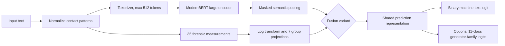

# FLAIRD Model Architecture

## System Overview

FLAIRD (Forensic Linguistic and AI-Integrated Robust Detector) combines contextual text representations from `answerdotai/ModernBERT-large` with a fixed vector of computational forensic-linguistic measurements. A configurable fusion module joins the two evidence streams. A binary classification head predicts human versus machine-generated text; an optional auxiliary head predicts one of ten generator families or the human class.

The model implementation is in `src/flaird/modeling/`; the eight completed experiment configurations are in `configs/`.

Text normalization replaces email addresses, user mentions, and phone-like strings with `[EMAIL]`, `[USER]`, and `[PHONE]`. The data collator applies this preprocessing before tokenization. Stored forensic vectors are used when provided; otherwise, features are extracted from the input text.

## Forensic Feature Stream

`ForensicFeatureExtractor` produces 35 ordered, deterministic scalar measurements. Non-finite values are replaced by zero. The feature encoder applies a signed logarithm to each value,

$$
\tilde{x}_i=\operatorname{sign}(x_i)\log(1+|x_i|),
$$

then maps each linguistic group through a learned linear projection, GELU, layer normalization, and dropout. Each group becomes a 128-dimensional feature state.

| Group | Feature names |
| --- | --- |
| `lexical_diversity` | `ttr`, `root_ttr`, `log_ttr`, `mtld`, `yule_k`, `yule_i`, `hapax_ratio`, `dis_hapax_ratio`, `sichel_s`, `honore_r` |
| `function_word_style` | `determiner_ratio`, `preposition_ratio`, `conjunction_ratio`, `pronoun_ratio`, `auxiliary_ratio`, `function_word_ratio`, `function_word_diversity` |
| `surface_composition` | `avg_word_length`, `vowel_consonant_ratio`, `digit_ratio`, `uppercase_ratio`, `whitespace_ratio` |
| `structural_organization` | `avg_sentence_length_chars`, `sentence_length_cv`, `paragraph_length_cv`, `newline_density` |
| `punctuation_and_rhetoric` | `punctuation_density`, `punctuation_variety`, `question_density`, `exclamation_density`, `quote_density` |
| `information_entropy` | `character_bigram_entropy`, `word_bigram_entropy` |
| `repetition_and_burstiness` | `word_burstiness`, `repeated_bigram_ratio` |

The feature names and order are defined in `src/flaird/modeling/features.py`; the group indices are defined in `configuration_flaird.py`. These are explicit indicators, not claims that any one style is uniquely human or machine-written.

## Semantic Stream and Pooling

The tokenizer truncates sequences to 512 tokens in the completed experiment configurations. ModernBERT produces contextual token states $H\in\mathbb{R}^{L\times d}$. The default pooling is a masked mean:

$$
s=\frac{\sum_{t=1}^{L}m_t H_t}{\max(1,\sum_{t=1}^{L}m_t)},
$$

where $m_t$ is the attention mask. The model also supports `cls` pooling, but the saved experiment configurations use the default `mean` pooling.

## Fusion Alternatives

### Attention and gated fusion

The attention variant normalizes the pooled semantic state and the seven feature-group states. The semantic vector acts as a single query over feature-group keys and values using eight-head multi-head attention. The resulting context $c$ is combined with semantic state $s$ by a learned vector gate:

$$
g=\sigma(W_g[s;c]+b_g),\qquad m=c+g\odot(s-c).
$$

The interaction representation concatenates the gated state with the elementwise semantic-context product, then projects it to the encoder hidden size:

$$
h_f=\operatorname{Dropout}(\operatorname{GELU}(\operatorname{LN}(W_o[m;s\odot c]+b_o))).
$$

The attention module returns group-level attention weights averaged across heads and a scalar mean of the gate dimensions. These values expose model behavior; they do not establish causal feature importance.

### Concatenation baseline

The concatenation variant mean-pools the projected feature-group states to $\bar{f}$ and combines that vector with the pooled semantic representation:

$$
h_f=\operatorname{Dropout}(\operatorname{GELU}(\operatorname{LN}(W_c[s;\bar{f}]+b_c))).
$$

This baseline has no attention weights or learned semantic-versus-forensic gate. The corresponding fields are absent at inference.

## Prediction Heads and Objective

A shared prediction head applies a dense layer, the configured activation (GELU in these runs), and layer normalization. The binary classifier emits one logit $z$; its machine probability is $\sigma(z)$. The multi-task configurations also emit logits for 11 generator labels: GPT, Meta-LLaMA, MPT, Cohere, Mistral, Gemini, DeepSeek, Falcon, Bison, Qwen, and human.

The implemented training objective is binary cross-entropy with a positive-class weight, plus an optional weighted generator cross-entropy:

$$
\mathcal{L}=\operatorname{BCEWithLogits}(z,y;w_{+})+\lambda\operatorname{CE}(u,g;w_g),
$$

where the auxiliary term is omitted for single-task models. All eight configurations use $w_{+}=0.0311727005543984$; multi-task configurations use $\lambda=0.2$ and the generator class weights stored in their JSON files. The weight reduces the contribution of the majority machine class in the binary loss; its practical calibration effect requires separate evaluation.

## Experiment Matrix

The completed design crosses three binary choices, producing eight configurations:

| Factor | Values | Purpose |
| --- | --- | --- |
| Fusion | Attention; concatenation | Compare learned feature-group attention/gating against pooled feature concatenation. |
| Generator objective | Multi-task; binary-only | Test whether generator-family supervision helps the primary binary task. |
| Encoder | Trainable; frozen | Compare full fine-tuning with holding the pretrained semantic encoder fixed. |

Shared recorded settings include ModernBERT-large, maximum sequence length 512, seed 42, one epoch, learning rate `2e-5`, AdamW fused, weight decay `0.01`, cosine scheduling, gradient clipping at `1.0`, BF16, and step-based evaluation/checkpointing. Train/evaluation batch sizes are 128 for trainable encoders and 256 for frozen encoders. The JSON files record `warmup_steps: 0.06`; this is the configured value and should not be silently restated as a 6% warmup ratio. Most runs select the best checkpoint by validation loss; the attention single-task frozen configuration does not set `load_best_model_at_end` in its JSON.

Detailed PAN26 and RAID results are in [evaluation-results.md](evaluation-results.md). Dataset construction and reproducibility cautions are in [dataset-preparation.md](dataset-preparation.md).

## Explanation and Intended Use

The inference helper reports the binary score, optional generator probabilities, signed gradient-times-input feature attributions, and attention-group weights when available. The signed attribution for feature $i$ is

$$
a_i=x_i\frac{\partial z}{\partial x_i}.
$$

It is a local model sensitivity summary, not a counterfactual explanation or proof of authorship. Attention weights describe allocation inside the fusion operation; they are not causal importance scores. See [explanation_module.md](explanation_module.md) for the output contract and limitations.

FLAIRD is an English-focused research decision-support tool. Its score should not be used as standalone evidence or an automated high-impact decision. Domain shift, paraphrasing, unseen generators, text truncation, and class imbalance remain material risks.
